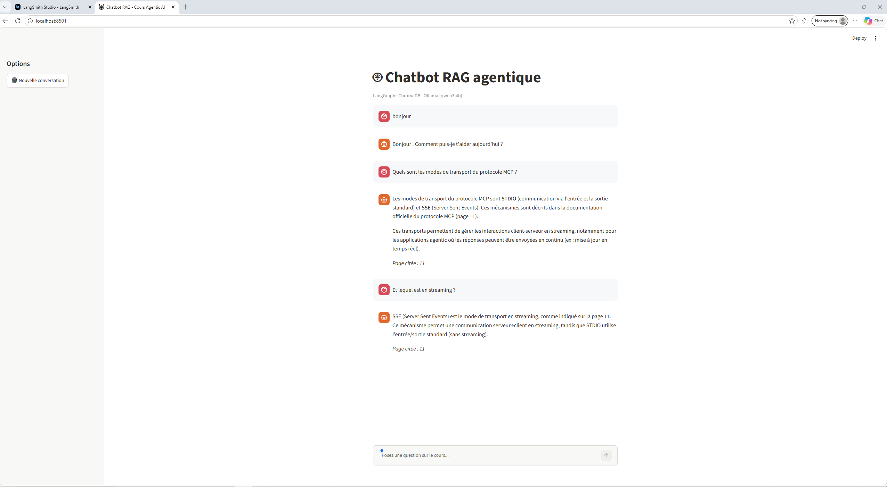
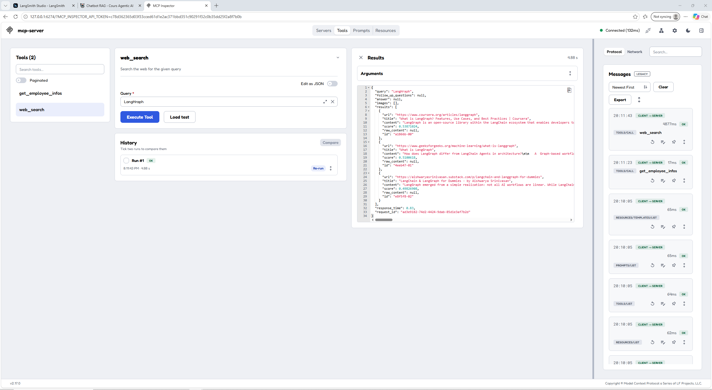
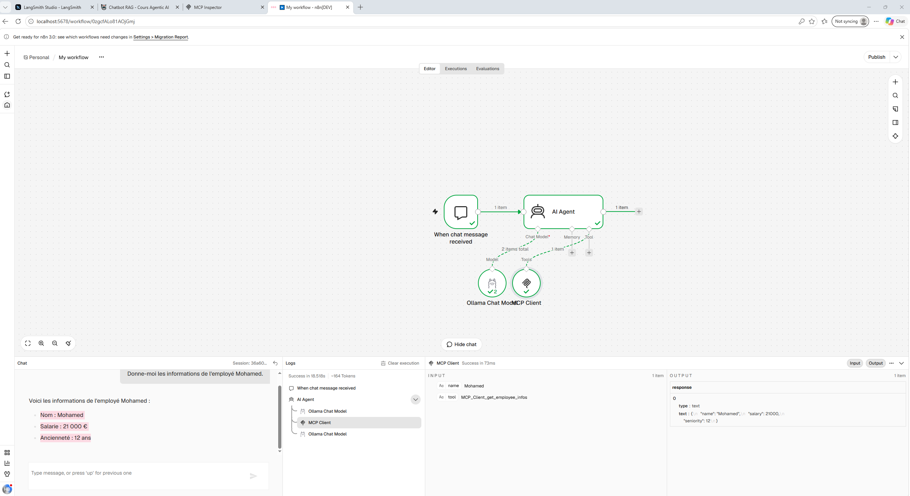
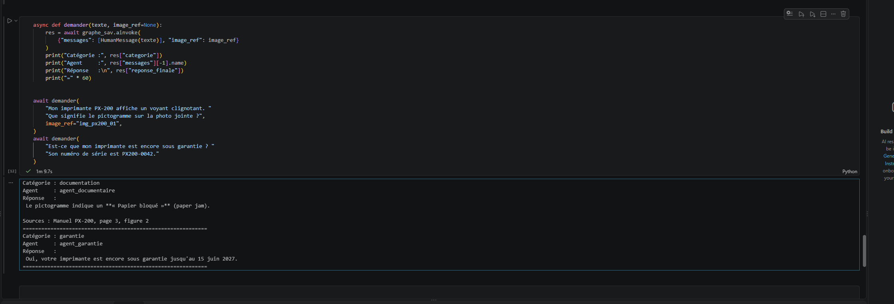

# Agentic AI et MCP : TP5

Agents IA avec LangChain et LangGraph, RAG agentique, serveur MCP et orchestration multi-agents.
LLM local : Ollama (qwen3:4b, qwen3:1.7b) · Embeddings : nomic-embed-text

## Progression
### A. LangChain
- [x] Étape 0 : Initialisation
- [x] Étape 1 : Agent simple + mémoire
- [x] Étape 2 : Tools personnalisés
- [x] Étape 3 : Tools prédéfinis (DuckDuckGo, Tavily, PythonREPL)
- [x] Étape 4 : Middlewares
- [x] Étape 5 : Chatbot RAG agentique

### B. LangGraph
- [x] Étape 6 : Bases de LangGraph
- [x] Étape 7 : Chatbot Agentic RAG
- [x] Étape 8 : LangGraph Studio
- [x] Étape 9 : Interface Streamlit

### C. MCP
- [x] Étape 10 : Serveur MCP (2 tools) + Inspector
- [x] Étape 11 : Agent LangChain client MCP (streamable-http)
- [x] Étape 12 : Agent n8n client MCP

### D. Synthèse
- [x] Étape 13 : SAV multi-agents
- [x] 13a : agent_garantie + outil local consulter_garantie
- [x] 13b : orchestrateur LangGraph (routage documentation / garantie)
- [x] 13c : RAG multimodal (texte + images du PDF dans ChromaDB)
- [x] 13d : serveur MCP SAV (rag_multimodal) + agent_documentaire
- [x] 13e : tests des deux exemples du sujet (documentation et garantie)

## Installation
    uv sync
    ollama pull qwen3:4b
    ollama pull qwen3:1.7b
    ollama pull nomic-embed-text
## LangGraph Studio

    uv run langgraph dev

## Interface Streamlit

    uv run streamlit run src/tp5_agents/app_streamlit.py

## Étape 10 : serveur MCP et test avec l'Inspector

Serveur FastMCP (`src/tp5_agents/mcp_server.py`) exposé en streamable-http sur `http://localhost:23000/mcp`, avec deux outils : `get_employee_infos` et `web_search` (Tavily).

Lancement :

    uv run python src/tp5_agents/mcp_server.py
    npx @modelcontextprotocol/inspector

## Étape 11 : agent LangChain client MCP

Agent `create_agent` qui découvre ses outils (`get_employee_infos`, `web_search`) via `MultiServerMCPClient` en `streamable_http` sur `http://localhost:23000/mcp`. Les outils MCP étant asynchrones, l'agent est appelé avec `ainvoke`.
## Étape 12 : agent n8n client MCP

Workflow n8n (Chat Trigger, AI Agent, Ollama Chat Model `qwen3:4b`, MCP Client Tool en HTTP Streamable sur `http://127.0.0.1:23000/mcp`).
Le workflow exporté est dans `docs/n8n_workflow.json`.

## Étape 13 : système SAV multi-agents (partie D)

Graphe LangGraph : `orchestrateur` classe la demande (documentation ou garantie), puis la route vers un seul agent spécialisé avant la fin.

- `agent_documentaire` : appelle l'outil distant `rag_multimodal` publié par un serveur MCP (`src/tp5_agents/mcp_sav_server.py`, port 23001, streamable-http). Derrière l'outil : la photo du client est décrite par `qwen2.5vl:3b`, puis un agent RAG cherche dans un index ChromaDB qui contient le texte et les images du manuel PDF, et répond en citant ses sources.
- `agent_garantie` : appelle l'outil local `consulter_garantie`, qui lit en lecture seule `sav/registre_garanties.json`.

Lancement :

    uv run python -m tp5_agents.sav_rag              (indexation du manuel, une fois)
    uv run python -m tp5_agents.mcp_sav_server       (serveur MCP du SAV)

puis exécuter `notebooks/sav_multiagents.ipynb`.

Limite connue : le modèle de vision local (3 milliards de paramètres) peut mal décrire une photo. Le prompt de description a donc été limité au pictogramme affiché.

